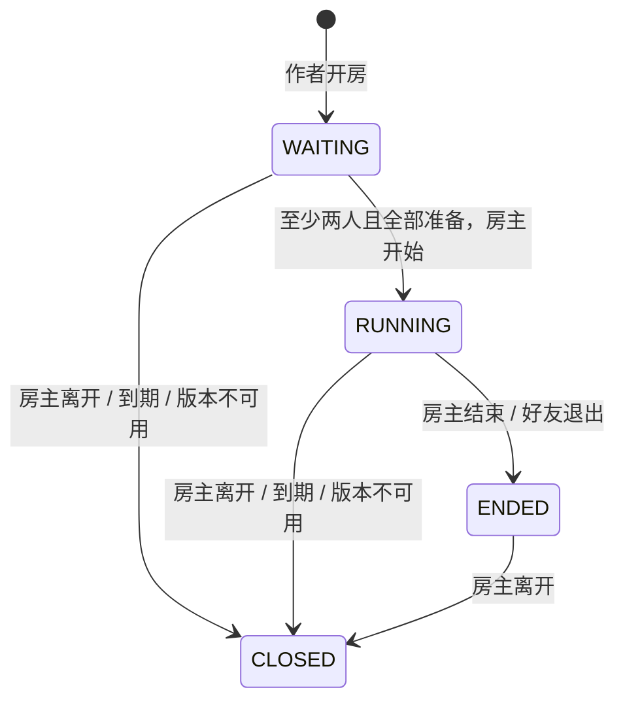

# 房间与邀请基础逻辑：隔离验证切片

本切片实现房间元数据状态机、短期邀请、幂等请求和已有账号接口的适配层。**没有房间 HTTP 路由、WSS 服务、持久化房间数据库或实际游戏同步。** `RUNNING` 仅表示房间成员已准备并被房主标记开始，不表示 Godot 已联机。

## 架构与实现边界

现有账号使用 `getCurrentUser()` 和会话 Cookie；作者资格使用 `isAdminUser()`。`Game` 已有 `plannedPlayMode`，`GameVersion` 有固定版本 ID 和公开版本指针，但此前没有房间/成员/邀请数据。

- `src/lib/game-rooms.ts`：纯逻辑，绑定游戏与版本，验证状态转换，输出无 token hash/请求摘要的成员视图。不读取配置、数据库或网络。
- `src/lib/game-rooms-service.ts`：校验客户端命令，从可信账号解析器得到操作者，把一次房间变更和幂等记录交给同一个仓储事务。客户端不能指定操作者或房主。
- `src/lib/game-rooms-platform.ts`：复用真实代码中的 `getCurrentUser`/`isAdminUser` 和 `db.gameVersion.findUnique` 读取接口。没有注册路由或默认仓储，必须由未来服务端显式接入。
- `tests/fixtures/in-memory-room-store.ts`：仅测试用串行仓储，模拟提交和回滚；不能用于生产、多实例或长期保留。

**账号适配代码已接到现有函数，但本轮没有真实登录/认证链路实测。** 五项适配器测试在导入前替换了认证和数据库模块，未读取 `.env`、用户记录或会话。不存在绕过登录的公开测试入口。

## 第一版产品规则

| 项目 | 规则 |
| --- | --- |
| 开房 | 已验证邮箱的作者管理员，只能为自己的作品开房 |
| 游戏 | 当前公开、标为 `MULTIPLAYER`/`BOTH` 的 Godot Web 版本；该标记仅为计划，不证明工程支持联机 |
| 版本 | 房间固定绑定 game ID/version ID/版本号，不自动升级或跨版本加入 |
| 成员 | 房主包含在人数内，2–8 人，默认上限 4 人 |
| 邀请 | 房主在等待状态签发，绑定接收账号；默认 15 分钟，允许 1–30 分钟，一次使用，不能晚于房间到期 |
| 房间有效期 | 默认 120 分钟，可选 30–120 分钟；过期后关闭 |
| 准备 | 每个账号只能改变自己的 ready；加入/退出等待房间会清空所有旧准备信号 |
| 开始 | 仅房主、至少两人、全部准备；开始后拒绝加入/新邀请/准备变更 |
| 结束 | 房主结束运行中的房间；运行中好友退出也结束本局，避免静默改变参与名单 |
| 房主离开 | **立即关闭，不转交**，等待中和运行中均适用 |
| 版本不可用 | 下架、归档、当前公开版本改变、作者归属改变或版本不存在时关闭，不重绑 |
| 再玩一局 | 新建房间；本切片不提供 ENDED→WAITING 的重置流程 |



关闭时撤销邀请、清空 ready，保留原成员记录供关闭通知与审计，不代表仍有活动连接。正常好友离开后不能再读取房间；退出的重复确认只返回空成员列表。过期与版本失效是调用时处理的被动逻辑，没有后台计时器；未来服务必须触发定时回收和关闭广播。

## 调用与重复请求

服务端 `createRoomService` 接受可信账号解析器、版本读取器和事务仓储。测试可注入时钟和明显虚构的邀请生成器；默认生成器使用随机 UUID 和 32 字节短期邀请 token，但本次没有通过真实服务签发或发送任何邀请。

创建输入：`requestId`、`gameId`、`versionId`，可选 `maxPlayers`、`lifetimeMinutes`。房间命令共用 `requestId`、`gameId`、`versionId`；按动作增加以下字段：

| type | 额外字段 |
| --- | --- |
| `ISSUE_INVITE` | `recipientUserId`、可选 `ttlMinutes` |
| `JOIN` | `inviteToken` |
| `READY` | `ready` |
| `LEAVE` / `START` / `END` | 无 |

输入是 strict schema；多余的 `userId`/`hostUserId` 字段会被拒绝。好友账号标识在本切片中由测试提供，没有好友目录、真实收件人解析或邀请发送功能。

成功请求按账号和 request ID 记录参数指纹。同一请求重复执行返回当前房间视图，且不重复消费邀请、占用席位或改变 revision；同一 ID 换参数会拒绝。失败请求不占用成功请求的 ID，因此满房或事务失败后可重试。幂等响应表示先前操作已接受，**客户端仍须读当前 state/revision，不能把过期房间的重试成功理解为仍在运行**。

邀请明文只出现在第一次签发结果，仓储保存带域分隔的 SHA256 哈希。重复签发请求不恢复明文，返回 `retryTokenOmitted: true`；若首次响应丢失，用新请求 ID 签发，新邀请会撤销同接收人的旧邀请。不要把 token 放进日志或持久化幂等响应。

每房最多 32 次邀请、200 个成功命令记录；达到上限仍允许退出，以免无法关闭。退出会淘汰最老记录保持上限，房间需要重新创建继续使用。未来还需作者开房数量和请求频率限制，当前没有公开接口。

## 仓储与发布并发的前置条件

`RoomRepository.transaction` 必须串行化相同房间的成员数、邀请消费和幂等记录，并在异常时整体回滚。mock 仓储只证明这份接口契约下不会满房超员，不证明真实 PostgreSQL/Redis 的锁正确。

未来持久化仓储还必须提供 `RoomTransaction.loadBuild`，在**同一事务**中读取公开版本与作者归属，并与现有发布/回滚流程共用游戏级锁，再加房间级锁，锁顺序保持一致。平台适配器的普通只读查询是尚未接入仓储事务的 fallback；不能据此宣称真实发布与入房并发已解决。当前没有新增 Prisma schema 或执行迁移。

持久化结构至少需要 Room、RoomMember、RoomInvite 和 RequestReceipt，唯一约束覆盖 room/user、tokenHash、actor/request ID；绑定版本应有外键和一致性约束。事务成功后再用 outbox 或提交回调广播，禁止广播未提交状态。异常转换为通用失败码，不输出 SQL、邀请或会话详情。

## WSS 后续接入

1. 主站受认证、Origin/CSRF 检查的 API 调用平台服务；不接受浏览器传来的操作者 ID。先完成真实登录、作者归属和隔离数据库事务验收。
2. 成员加入后，由服务端签发极短期、一次性 WSS bootstrap ticket，绑定账号、会话、房间、游戏和版本。游戏 iframe 不持有主站长期 Cookie；本切片没有实现或签发这种 ticket。
3. 独立 WSS 服务在握手时验证 ticket、精确 Origin、成员身份和版本，消费 ticket；持续重验房间/会话有效性。用 revision 与请求 ID处理重试、断线和状态重同步。
4. 提交后广播成员/准备/开始/结束/关闭事件。检测房主连接断开后按明确的宽限或立即关闭规则执行；当前逻辑只处理显式 `LEAVE`，不能发现网络断线。
5. Godot 工程实现匹配协议的输入、游戏状态和结果同步。权威状态、反作弊、延迟补偿、位置/物理同步、音频、存档和断线重连均未实现。
6. 现有运行时 CSP 的 `connect-src 'self'` 不放行独立 WSS；正式接入前需单独审查精确 allowlist、速率/消息大小、TLS 和资源边界，不能直接放开所有网络。

WSS、数据库 schema 和 Godot 游戏协议都是后续实现项，本次没有开端口、发真实邀请、创建长期凭据或部署。

## 本地验收

```text
npm run test:rooms
npm run test:rooms:platform
```

26 项核心/service mock 与 5 项实际适配代码的模块 mock 覆盖：账号/归属、版本与状态、人数边界、邀请有效期/账号/房间绑定、重复请求、满房并发、准备撤销、开始/结束、房主关闭、好友离开、公开版本改变、事务失败重试、事务内版本读取契约和状态大小上限。真实认证、持久化事务、WSS、网络断线与 Godot 联机仍需独立验收。
